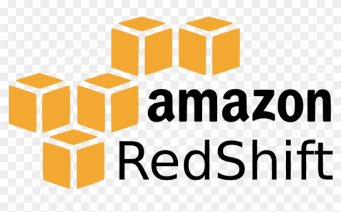

# DB MCP Gateway

Give Claude Code, Cursor, Windsurf, or any MCP-compatible AI tool **read-only access to your databases** — without exposing credentials or risking data changes.

Self-hosted. Everything runs locally. Your passwords never leave your machine.


https://github.com/user-attachments/assets/f768ff6f-3c9e-4583-9179-c7022d3b7487


### Supported databases

| | Database | Notes |
|---|---|---|
|  | **PostgreSQL** | All versions |
|  | **MySQL** | MySQL 5.7+ / MariaDB |
|  | **SQLite** | Local file, no server needed |
|  | **Amazon Redshift** | SSL required, Redshift-specific catalog queries |

---

## What it does

Instead of copy-pasting query results between your DB client and your AI tool, the gateway lets your AI query the database directly. It can explore schemas, inspect tables, and run SELECT queries. It **cannot** insert, update, delete, or drop anything.

---

## Quick Start

Requires Node.js 22 or newer.

**1. Start the gateway** (creates `~/.db-mcp/` on first run):

```bash
npx @mdadul/db-mcp            # or: npm install -g @mdadul/db-mcp && db-mcp
```

Open `http://localhost:4080` to add your databases.

**2. Connect your AI tool:**

```bash
db-mcp install                # pick a client from the list
db-mcp install claude-code    # or name one directly
```

Restart the tool afterwards. Other clients, and manual setup: [docs/installation.md](docs/installation.md).

**Stdio alternative** for clients that launch MCP servers as a subprocess (no
HTTP server, no token):

```json
{ "mcpServers": { "db-mcp": { "command": "npx", "args": ["-y", "@mdadul/db-mcp", "stdio"] } } }
```

Stdio reads the same databases you configured in the dashboard, so start the
gateway once first to add them.

---

### Docker (alternative, no Node.js required)

```bash
git clone https://github.com/mdadul/db-mcp
cd db-mcp

# Generate .env with secure random keys, then start
sh scripts/setup.sh
docker compose up
```

`docker compose` pulls the pre-built image from Docker Hub — no build step required.  
The `MCP_TOKEN` is stored in `.env` (read it with `grep MCP_TOKEN .env`).

---

## Connect your AI tool

The easiest way — run this once (from anywhere) and pick your tool from the list:

```bash
db-mcp install
```

This writes the right config file for you automatically, with the correct URL
and token already filled in. Restart your tool afterwards.

Or skip the picker and go straight to a client:

```bash
db-mcp install claude-code     # Claude Code (CLI)
db-mcp install claude-desktop  # Claude Desktop
db-mcp install cursor          # Cursor
db-mcp install windsurf        # Windsurf
db-mcp install opencode        # opencode
db-mcp install vscode          # VS Code (writes .vscode/mcp.json in the current project)
```

Full per-client guide (manual config, Gemini CLI, Codex, Cline, troubleshooting): [docs/installation.md](docs/installation.md).

<details>
<summary>Manual setup</summary>

#### Claude Code (CLI)

```bash
claude mcp add --transport http db-mcp http://localhost:4080/mcp \
  --header "Authorization: Bearer <MCP_TOKEN>"
```

Then restart Claude Code.

#### Cursor / Windsurf / Claude Desktop

Add to your `mcp.json`:

```json
{
  "mcpServers": {
    "db-mcp": {
      "url": "http://localhost:4080/mcp",
      "headers": {
        "Authorization": "Bearer <MCP_TOKEN>"
      }
    }
  }
}
```

</details>

#### Claude.ai Web

Claude.ai requires HTTPS. Expose the gateway through a tunnel first:

```bash
# Option A — Cloudflare (no account needed)
npx cloudflared tunnel --url http://localhost:4080

# Option B — ngrok
ngrok http 4080
```

Copy the `https://...` URL from the tunnel output, then add it in Claude.ai → Settings → Integrations → Add MCP Server.

---

## Using it with your AI

Once connected, just ask naturally:

> "How many orders were created this week?"
> "What columns does the `users` table have?"
> "Show me the last 10 failed jobs."

The AI will call the gateway tools automatically — no copy-pasting.

### Available tools

| Tool | What it does |
|------|-------------|
| `list_databases` | Lists all connected databases |
| `get_database_schema` | Lists tables (optional name filter) |
| `get_table_schema` | Shows columns, indexes, and foreign keys for a table |
| `execute_read_query` | Runs a SELECT query (capped at 100 rows by default, max 1000) |

---

## Configuration

A `.env` file with secure random values is generated automatically on first
run — you don't need to create one by hand. The few settings you might want
to change:

| Variable | Description |
|---|---|
| `PORT` | HTTP port the gateway listens on (default: `4080`) |
| `HOST` | Interface to bind (default: `127.0.0.1`, so only this machine can reach it). Docker sets `0.0.0.0`. |
| `DB_MCP_HOME` | Where the npm package stores its config and SQLite file (default: `~/.db-mcp`) |

**Back up `ENCRYPTION_KEY`.** It lives only in `.env`. If you lose the file,
the saved database passwords can't be decrypted and you'll need to re-enter
them in the dashboard.

The dashboard at `http://localhost:<port>` is where you add and manage your
database connections after the gateway is running.

---

## Troubleshooting

**Tools not showing up in Claude Code**
Restart Claude Code after adding the MCP server. If still missing, run `claude mcp list` to confirm it's registered and shows `✓ Connected`.

**"Failed to connect" in Claude Code**
Check the gateway is running (`http://localhost:4080` should load) and the token in your config matches `.env`.

**"URL must start with https"** (Claude.ai Web)
Claude.ai blocks plain HTTP. Use a tunnel — see the Claude.ai Web setup above.

**Connection refused to my database**
If the gateway runs in Docker and your database is on the host, use `host.docker.internal` instead of `localhost` as the host.

---

## Security model

- **Read-only.** Queries must pass a read-only check (`SELECT`, `SHOW`,
  `DESCRIBE`, `EXPLAIN`; MongoDB queries are a JSON find-style DSL with
  write and server-side-code operators rejected). This check is a guard, not
  the only defence: **create a read-only database user for each connection**
  and give the gateway only that user's credentials.
- **Local by default.** The gateway binds to `127.0.0.1`. Only set `HOST` to a
  network address if you understand that anyone who can reach it and has the
  token can query your databases.
- **Token.** Every `/mcp` request needs `Authorization: Bearer <MCP_TOKEN>`.
  The token is stored in `.env` (never printed). Treat it like a password and
  don't commit `.env`. Reinstall the client config if you change it.
- **Encryption.** Database passwords are encrypted with AES-256-GCM. The key
  is `ENCRYPTION_KEY` in `.env`; it is never stored in the database.
- **Stdio mode** has no token: anyone who can run `db-mcp stdio` as your user
  can read the same `.env`, so it's as protected as your home directory.
- **Tunnels.** Exposing the gateway with cloudflared or ngrok (needed for
  Claude.ai web) makes it reachable from the internet. Only the token protects
  it, so stop the tunnel when you're not using it.

---

## Contributing

Want to run this from source, add a feature, or cut a release? See
[CONTRIBUTING.md](CONTRIBUTING.md).


